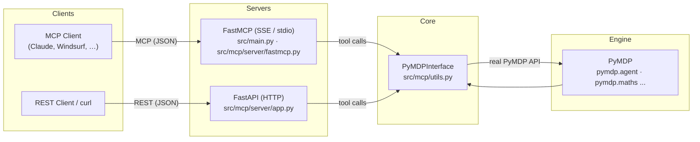
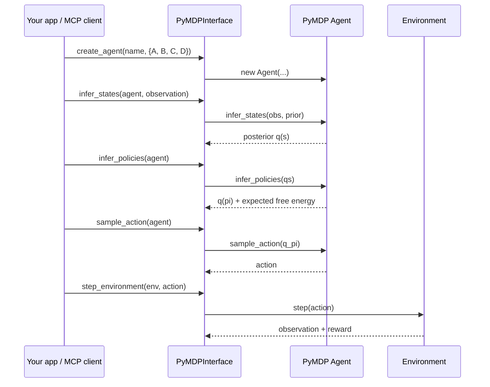
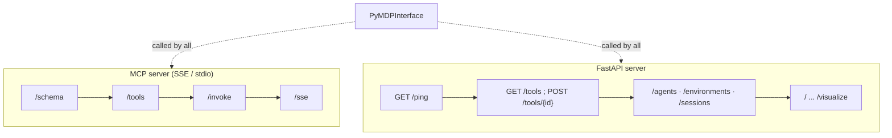

# 🧠 PyMCP — MCP + REST for PyMDP Active Inference

**Expose the [PyMDP](https://github.com/infer-actively/pymdp) active-inference
library to AI agents and applications over the Model Context Protocol (MCP)
and a plain REST API.**

[](https://www.python.org/)
[](#)
[](#)
[](LICENSE)
[](#)

`pymcp` gives any MCP-compatible client (Claude Desktop, Windsurf, …) — or any
REST caller — direct, reproducible access to PyMDP's discrete-state-space
active inference engine: build generative models, create agents, infer hidden
states and policies (free-energy minimization), and simulate agents in
environments. There are **no mock or simplified implementations**: every call
goes straight to the real PyMDP library and returns results identical to using
PyMDP directly.

---

## Architecture



**Both servers are thin wrappers around one core class**, `PyMDPInterface`, so
MCP and REST behave identically — the same tool in, the same JSON out.

---

## Key features

- **Model Context Protocol** — `@mcp.tool()` tools delivered over **SSE** or
  **stdio**, auto-discoverable by any MCP client.
- **REST API** — a FastAPI server (`/ping`, `/tools`, `/agents`,
  `/environments`, `/sessions`, …) for HTTP callers.
- **Full active-inference loop** — `create_agent` → `infer_states` →
  `infer_policies` → `sample_action` → `step_environment`, or end-to-end via
  `run_simulation`.
- **Grid-world environments** — create spatial environments with rewards and
  simulate navigation.
- **Visualization** — belief dynamics, policy posteriors, free-energy traces,
  and generative-model plots (PNG + JSON companions).
- **JSON in / JSON out** — inputs and outputs are plain JSON (NumPy/JAX values
  are converted automatically), so it is trivial to call from any language.

---

## Installation

Using [uv](https://docs.astral.sh/uv/):

```bash
# 1. Install this package (fastapi, uvicorn, numpy, matplotlib, aiohttp, ...)
uv pip install -e .

# 2. Install the PyMDP engine
uv pip install inferactively-pymdp
```

> PyMDP is already declared as a dependency in `pyproject.toml`
> (`inferactively-pymdp>=1.0.3`), and step 2 just makes the engine explicit.
> There is **no vendored `pymdp-clone`** in this repository — the interface talks
> to the installed PyMDP package through its public API.

---

## Quickstart (interface directly)

```python
from mcp.utils import PyMDPInterface

pymdp = PyMDPInterface()

# Build a generative model: 1 observation modality [obs, state], 1 control factor
model = pymdp.define_generative_model(A_dims=[[2, 3]], B_dims=[[3, 3, 2]])

# Create an agent from that model
pymdp.create_agent("agent_1", model)

# Create a 3x3 grid world with a reward in the bottom-right
pymdp.create_grid_world_env("world_1", [3, 3], [[2, 2]])

# Simulate the agent for 5 steps
result = pymdp.run_simulation("agent_1", "world_1", num_steps=5)
print(result["timesteps"])
```

### The active-inference loop



---

## The `PyMDPInterface` methods

Every MCP tool and HTTP endpoint is a thin wrapper over one of these:

| Method | Description |
| --- | --- |
| `create_agent(name, generative_model)` | Create an active inference agent from a model dict (`A`, `B`, optional `C`, `D`). |
| `define_generative_model(A_dims, B_dims)` | Build random `A`/`B` matrices + default `C`/`D` from dimension lists. |
| `create_gridworld_agent(name, grid_size, reward_positions, ...)` | Gridworld agent with position + reward observation models. |
| `create_grid_world_env(name, grid_size, reward_positions)` | Create a grid world environment with rewards. |
| `infer_states(agent_id, observation, method="FPI")` | Infer hidden-state posterior for an observation (FPI, BP, …). |
| `infer_policies(agent_id)` | Optimize beliefs over policies via expected free energy. |
| `sample_action(agent_id)` | Sample an action from the policy posterior. |
| `step_environment(env_id, action)` | Advance an environment given an action. |
| `run_simulation(agent_id, env_id, num_steps=10, ...)` | Run a full agent–environment simulation loop. |
| `reset_environment(env_id)` | Reset an environment to its initial state. |
| `get_agent(name)` / `get_environment(name)` | Retrieve stored agents/environments as JSON. |
| `get_all_agents()` / `get_all_environments()` / `get_all_simulations()` | List stored resources. |
| `get_all_functions()` | List all public methods on the interface. |

Additional helpers include `validate_generative_model`,
`calculate_free_energy`, `infer_states_from_observation`, and visualization
methods (`visualize_simulation`, `visualize_belief_dynamics`,
`visualize_agent_model`) — see [`docs/`](docs/).

---

## Server run modes

There are two independent servers.

### 1. MCP server (`src/main.py` + `src/mcp/server/fastmcp.py`)

```bash
TRANSPORT=sse uv run src/main.py      # SSE (default)
TRANSPORT=stdio uv run src/main.py    # stdio
```

### 2. FastAPI HTTP server (`src/mcp/server/app.py`)

```bash
uvicorn mcp.server.app:app
```



### Configuration environment variables

| Variable | Default | Description |
| --- | --- | --- |
| `HOST` | `0.0.0.0` | Host to bind (SSE server). |
| `PORT` | `8050` | Port to listen on (SSE server). |
| `TRANSPORT` | `sse` | Transport: `sse` or `stdio`. |
| `CORS_ORIGINS` | `http://localhost:8080,http://127.0.0.1:8080` | Allowed origins for the FastAPI server. |
| `MCP_OUTPUT_DIR` | `./output` | Directory where visualization files are written (path-traversal safe). |

---

## Testing

```bash
uv run python -m pytest tests/
```

The suite (54 tests) exercises `PyMDPInterface` directly **and** through the MCP
layer, verifying that the interface reproduces direct PyMDP results exactly.
Plots and artifacts are written under `tests/output/`.

---

## Documentation

- [Docs index](docs/README.md)
- [Architecture](docs/ARCHITECTURE.md)
- [MCP & PyMDP integration](docs/mcp_pymdp_integration.md)
- [MCP tools reference](docs/mcp_tools.md)
- [PyMDP integration](docs/pymdp_integration.md)
- [Implementation details](docs/implementation_details.md)
- [Advanced features](docs/advanced_features.md)
- [Implementation status report](mcp_status_report.md)
- [Changelog](CHANGELOG.md)

---

## Citation

If you use this project in research, please cite the underlying PyMDP library:

```bibtex
@article{Heins2022,
  doi = {10.21105/joss.04098},
  url = {https://doi.org/10.21105/joss.04098},
  year = {2022},
  publisher = {The Open Journal},
  volume = {7},
  number = {73},
  pages = {4098},
  author = {Conor Heins and Beren Millidge and Daphne Demekas and Brennan Klein and Karl Friston and Iain D. Couzin and Alexander Tschantz},
  title = {pymdp: A Python library for active inference in discrete state spaces},
  journal = {Journal of Open Source Software}
}
```

---

## License

This project is licensed under the [MIT License](LICENSE).
Copyright (c) 2025 Cole Medin.
