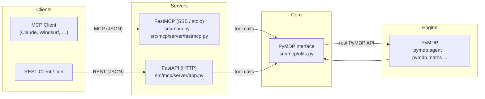
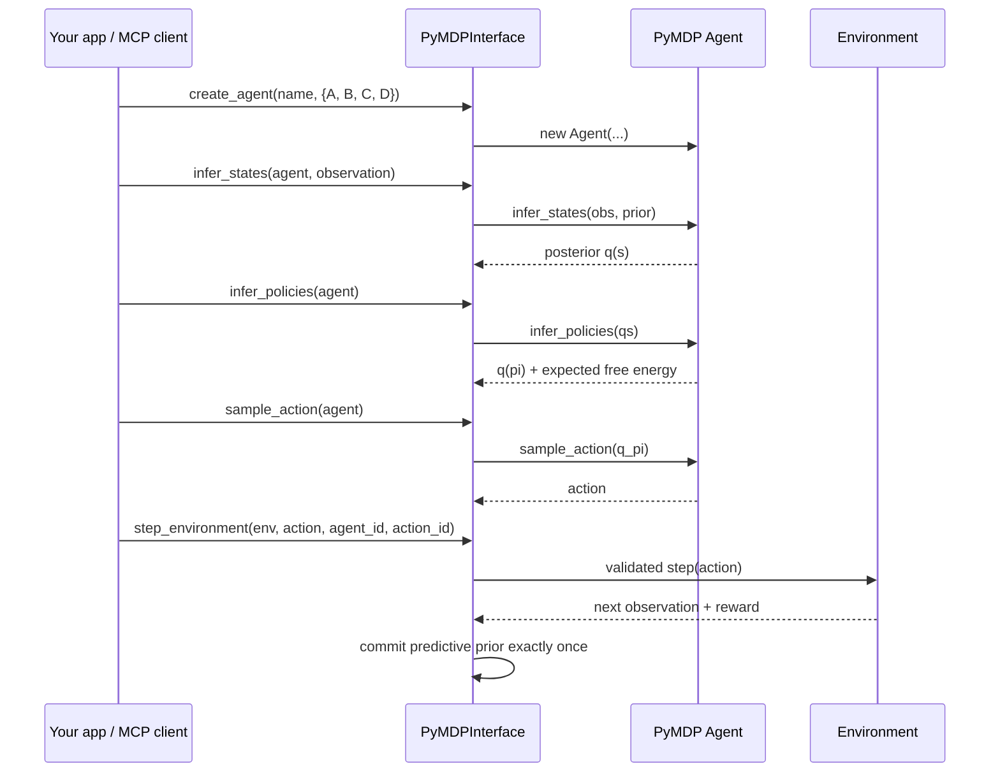

# 🧠 PyMCP — MCP + REST for PyMDP Active Inference

**Expose the [PyMDP](https://github.com/infer-actively/pymdp) active-inference
library to AI agents and applications over the Model Context Protocol (MCP)
and a plain REST API.**

[](https://www.python.org/)
[](#)
[](#)
[](LICENSE)
[](#)

`pymcp` exposes an explicit discrete-state filtering/planning contract using
the real installed PyMDP Agent. One strict registry serves bundled MCP,
REST and explicit in-process clients. Model admission, successful transition
commits, bounded histories and measured reporting are wrapper responsibilities;
this is not complete or automatically equivalent access to every PyMDP API.

---

## Contents

- [Status](#status)
- [Architecture](#architecture)
- [Key features](#key-features)
- [Installation](#installation)
- [Quickstart (interface directly)](#quickstart-interface-directly)
- [The `PyMDPInterface` methods](#the-pymdpinterface-methods)
- [Server run modes](#server-run-modes)
- [Testing](#testing)
- [Documentation](#documentation)
- [Citation](#citation)
- [License](#license)

## Status

The native contract targets the declared `inferactively-pymdp>=1.0.5`,
locked at 1.0.5. MCP (SSE/stdio), REST and direct clients share an explicit
registry, not cross-process state. Source qualification exercises native
models, lifecycle, real transports/processes and renderer/output contracts.

- Prepared dependencies are required; execution must not implicitly provision
  a different environment.
- The bundled MCP implementation is not an official-SDK adoption.
- Core/protocol/output/frame limits are explicit trusted launch configuration;
  they are not measured memory or latency guarantees.
- Full gate, installed-artifact/image and GNN/release proof remain separate.
  The existing pinned GNN verdict/shared-reader repairs are retained; see
  [the run guide](docs/RUN_GUIDE.md) and [backlog](TODO.md).

See [`docs/`](docs/README.md) for setup, testing, architecture and the tool
reference.

---

## Architecture



Both servers dispatch through the same strict registry and core contract.
Transport envelopes differ; each instance owns independent in-memory state.

---

## Key features

- **Model Context Protocol** — bundled `2025-03-26` JSON-RPC over SSE or stdio,
  with initialization, notifications, discovery and strict tool schemas.
- **REST API** — a single-worker FastAPI factory with actual JSON/image bytes.
- **Active-inference lifecycle** — observe → infer → plan → select →
  successful token-matched transition/commit, or `run_simulation`.
- **Grid-world environments** — create spatial environments with rewards and
  simulate navigation.
- **Visualization** — belief dynamics, policy posteriors, free-energy traces,
  and generative-model plots (PNG + JSON companions).
- **JSON in / JSON out** — inputs and outputs are plain JSON (NumPy/JAX values
  are converted automatically), so it is trivial to call from any language.

---

## Installation

When dependency provisioning is authorized, use the committed frozen lock:

```bash
./run.sh setup
```

`inferactively-pymdp` is already declared; do not independently upgrade it or
install the official `mcp` package over this bundled namespace.
For an existing prepared environment, launch its interpreter directly with
this checkout's `src` selected. Docker provisions uv 0.13.8 and a frozen,
no-dev/non-editable environment; source tests do not qualify the image.
See [setup](docs/setup.md) for exact launch and exposure boundaries.

---

## Quickstart (interface directly)

```python
from mcp.utils import PyMDPInterface

pymdp = PyMDPInterface()

# Matching position/reward modalities for the same 3x3 grid.
agent = pymdp.create_gridworld_agent("agent_1", [3, 3], [[2, 2]])
environment = pymdp.create_grid_world_env("world_1", [3, 3], [[2, 2]])
assert "error" not in agent, agent
assert "error" not in environment, environment

result = pymdp.run_simulation("agent_1", "world_1", num_steps=5)
assert "error" not in result, result
print(result["simulation_id"], result["num_steps"], result["requested_steps"])
```

### The active-inference loop



---

## The `PyMDPInterface` methods

Every MCP tool and HTTP endpoint is a thin wrapper over one of these:

| Method | Description |
| --- | --- |
| `create_agent(name, generative_model, normalize=False)` | Admit a native unbatched model and immutable construction settings. |
| `define_generative_model(A_dims, B_dims, seed=None)` | Build a bounded normalized model. |
| `create_gridworld_agent(name, grid_size, reward_positions, ...)` | Model matching the grid's position/reward modalities. |
| `create_grid_world_env(name, grid_size, reward_positions, ...)` | Real grid environment with explicit reset/terminal options. |
| `infer_states(agent_id, observation, method=None)` | Filter actual integer outcomes; unsupported method changes fail. |
| `infer_policies(agent_id)` | Retain complete policy posterior and signed EFE conventions. |
| `sample_action(agent_id)` | Return/cache a pending action and token without advancing the prior. |
| `step_environment(env_id, action, agent_id, action_id)` | Execute and commit a matching successful transition. |
| `commit_action(agent_id, action_id)` | Commit a caller-owned successful external transition instead. |
| `reset_agent(agent_id)` / `reset_environment(env_id)` | Distinct belief/token and physical-state resets. |
| `run_simulation(agent_id, env_id, num_steps=10, ...)` | Real run ID, requested/executed counts and measured history. |
| `create_session` / `run_session` / `get_session_history` | Process-local cumulative histories and actual run IDs. |
| `get_agent` / `get_environment` / `get_all_functions` | Detached native exports and explicit registry discovery. |

Additional helpers include `validate_generative_model`,
`calculate_free_energy`, `infer_states_from_observation`, and visualization
methods (`visualize_simulation`, `visualize_belief_dynamics`,
`visualize_agent_model`) — see [`docs/`](docs/).

---

## Server run modes

Use an existing prepared interpreter (`PROJECT_PY` is its absolute path)
from the repository root:

### 1. Bundled MCP

```bash
PYTHONPATH="$PWD/src" "$PROJECT_PY" -B src/main.py --transport stdio
PYTHONPATH="$PWD/src" "$PROJECT_PY" -B src/main.py --transport sse --host 127.0.0.1 --port 8050
```

### 2. REST

```bash
PYTHONPATH="$PWD/src" "$PROJECT_PY" -B scripts/start_fastapi_server.py --host 127.0.0.1 --port 8080 --output-dir /path/to/owned-output
```

The direct uvicorn target is `mcp.server.app:create_app --factory --workers 1`,
with explicit loopback binding and no reload. The eager `:app`, duplicate
`start_mcp_server.py` and automatic remote-to-direct fallback are retired.
Import `DirectMCPClient` explicitly from `mcp.client` when local mode is wanted.

REST tool bodies contain native `params` objects, not stringified models;
success has one result envelope, unwrapped once by the client. PNG/SVG routes
return actual image bytes with matching content type and query format.
Toolkit downloads are caller-owned local files, not returned server paths.

Instances share a contract, not state. Non-loopback exposure is an explicit
owner decision; no server authentication exists and CORS is not authentication.
Client `auth.enabled` controls token headers only. Configuration and bounded
output/protocol policy are in [setup](docs/setup.md); owned process examples
are in [scripts/README.md](scripts/README.md).

---

## Testing

```bash
./run.sh setup       # install the committed lock (Python 3.12)
./run.sh test        # fast arm: the suite minus the `slow` tests
./run.sh all         # lint, full suite, docs, pinned GNN conformance
```

`./run.sh` is the single gate entry point; both CI jobs call its arms, so there
is no second copy of a test or lint command anywhere. See the
[Run Guide](docs/RUN_GUIDE.md) for the arm list and
[`docs/_generated/gate-facts.md`](docs/_generated/gate-facts.md) for the
generated test counts and per-arm wall times.

The [focused contract inventory](tests/README.md) covers real native,
transport, filesystem, process and renderer paths using isolated temporary
outputs. A focused receipt is not a full gate, installed-image or scientific
qualification. Counts come from `scripts/gate_facts.py`, not from prose.

> The suite needs the resolved environment; on a bare interpreter without the
> declared dependencies `pytest` cannot import the modules and collection fails.
> See [Testing](docs/testing.md).

---

## Documentation

- [Docs index](docs/README.md)
- [Documentation index (flat list)](docs/documentation-index.md)
- [Run guide — the `./run.sh` gate](docs/RUN_GUIDE.md)
- [Generated gate facts](docs/_generated/gate-facts.md)
- [Setup and usage](docs/setup.md)
- [Testing](docs/testing.md)
- [Architecture](docs/ARCHITECTURE.md)
- [MCP & PyMDP integration](docs/mcp_pymdp_integration.md)
- [MCP tools reference](docs/mcp_tools.md)
- [PyMDP integration](docs/pymdp_integration.md)
- [Implementation details](docs/implementation_details.md)
- [Advanced features](docs/advanced_features.md)
- [Implementation status report](mcp_status_report.md)
- [Changelog](CHANGELOG.md)

---

## Citation

If you use this project in research, please cite the underlying PyMDP library:

```bibtex
@article{Heins2022,
  doi = {10.21105/joss.04098},
  url = {https://doi.org/10.21105/joss.04098},
  year = {2022},
  publisher = {The Open Journal},
  volume = {7},
  number = {73},
  pages = {4098},
  author = {Conor Heins and Beren Millidge and Daphne Demekas and Brennan Klein and Karl Friston and Iain D. Couzin and Alexander Tschantz},
  title = {pymdp: A Python library for active inference in discrete state spaces},
  journal = {Journal of Open Source Software}
}
```

---

## License

This project is licensed under the [MIT License](LICENSE).
Copyright (c) 2025 Cole Medin.

## InstituteOS sidecar

This repository carries a committed [`.aii/`](.aii/README.md) sidecar with curated
InstituteOS metadata (`aii-sidecar/v1`): category, maturity, ecosystem relations,
key artifacts, provenance, and portable tasks. It is read by
[InstituteOS](https://github.com/ActiveInferenceInstitute/InstituteOS) tooling and
does not affect the project's build or runtime.
