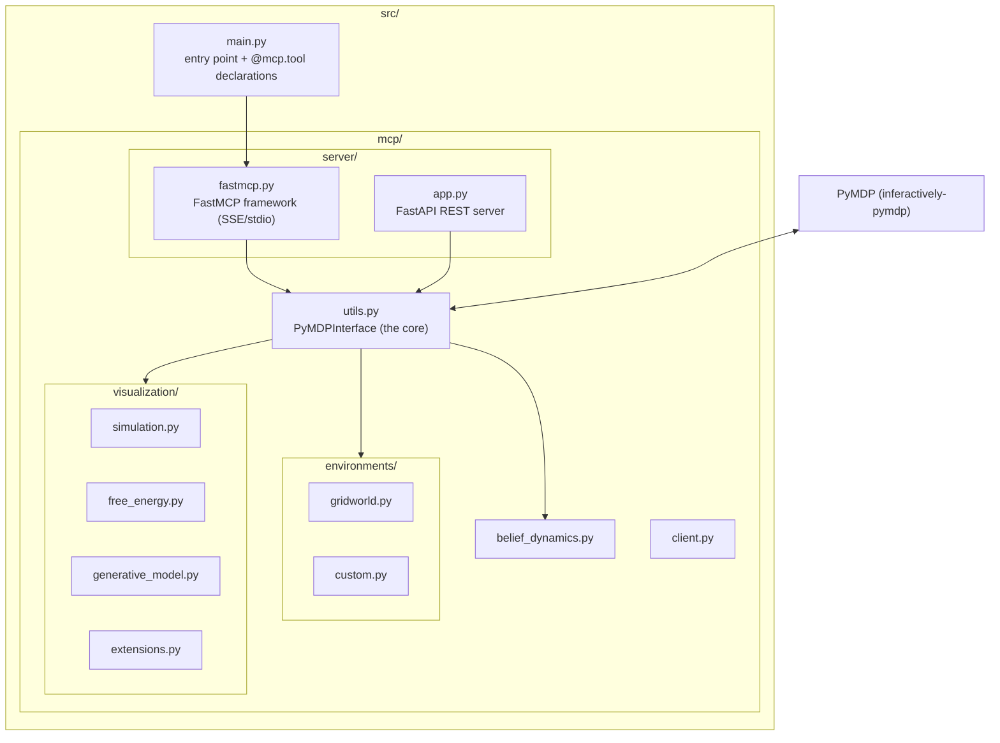
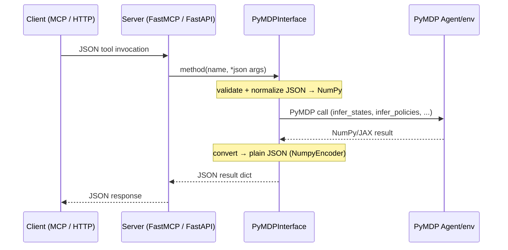
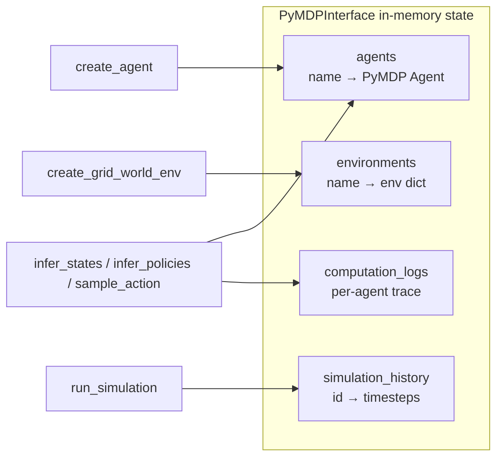

# Architecture

This document explains how `pymcp` is put together: where the code lives, how a
request flows from a client to PyMDP and back, and the design decisions that
keep the MCP and REST surfaces consistent.

## Module layout

## Request lifecycle

A single tool call travels through four layers. The goal is that **every layer
speaks JSON**, and only `PyMDPInterface` touches NumPy/JAX objects.

## Shared core: `PyMDPInterface`

Both servers delegate to the same methods, so behavior is identical whichever
surface you use.

## Key design decisions

1. **One interface, two transports.** Both the hand-rolled FastMCP layer
   (`src/main.py`) and the FastAPI server (`src/mcp/server/app.py`) are thin
   wrappers over `PyMDPInterface` (`src/mcp/utils.py`). No business logic leaks
   into either server; everything routes through `utils.py`.
2. **JSON boundary.** All public methods take/return JSON-serializable values.
   NumPy and JAX arrays are converted via `NumpyEncoder` and the
   `_convert_from_obj_array` / `_ensure_native_types` helpers.
3. **Real PyMDP, no mocks.** There is no `pymdp-clone` in the tree and no
   simplified implementation. The interface calls the installed
   `inferactively-pymdp` package's public API; the test suite verifies results
   match direct PyMDP calls.
4. **Immutable engine model.** Current PyMDP agents are immutable (equinox
   dataclasses). Configuration like `policy_len`, `inference_algo`, and learning
   flags is therefore passed at **construction time** in `create_agent`, not
   assigned afterwards.
5. **Batched observation convention.** Modern PyMDP uses a leading batch
   dimension. The interface adds/removes these automatically, so callers never
   see them (`_to_batch`, `_unwrap`, `_onehot_observations`).
