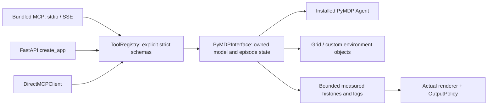

# Architecture

## Module layout

| Source | Responsibility |
| --- | --- |
| `src/main.py` | Bundled MCP entry point |
| `src/mcp/api.py` | Explicit tool registry, discovery, strict argument schemas, dispatch lock |
| `src/mcp/models.py` | Native model/settings admission and trusted limits |
| `src/mcp/utils.py` | Native Agent calls, predictive priors, pending-action commits, runs, sessions and numerical helpers |
| `src/mcp/environments/` | Real grid/custom objects and fixed observation contracts |
| `src/mcp/outputs.py` | Primary/companion path confinement and owned output writes |
| `src/mcp/server/fastmcp.py` | JSON-RPC lifecycle, stdio and bounded SSE channels |
| `src/mcp/server/app.py` | Explicit REST application factory, independent instance state |
| `src/mcp/client/` | HTTP client, explicit direct client, configuration and toolkit |
| `src/mcp/visualization/`, `belief_dynamics.py` | Actual model/history plots and derived measurements |

## Ownership and boundaries

Each core owns its native agents, environment objects, predictive priors,
pending action tokens and bounded histories. Sessions bind existing entities
and accumulate real run IDs. Data exported to a caller is detached.
Different MCP, REST or direct instances do not share these registries.

Selection is not transition execution. Only successful token-matched stepping
or a caller's explicit external commit advances the predictive prior.
Agent reset restores its prior and invalidates tokens; environment reset is
separate. See the [complete lifecycle](mcp_tools.md).

Public matrices are unbatched; batching is an internal Agent boundary.
Transport adapters do not invent observations, models, histories or free-energy
components. The bundled `mcp` package is not an official-SDK adoption.

## Operating boundary

REST is one process, one worker, no reload; neither sessions nor channels are
durable or distributed. MCP/REST bind loopback by default. Non-loopback exposure
requires an explicit operator decision; CORS and client token headers are not
server authentication. Native image/installed-package and release
qualification remain separate from source-contract proof.

